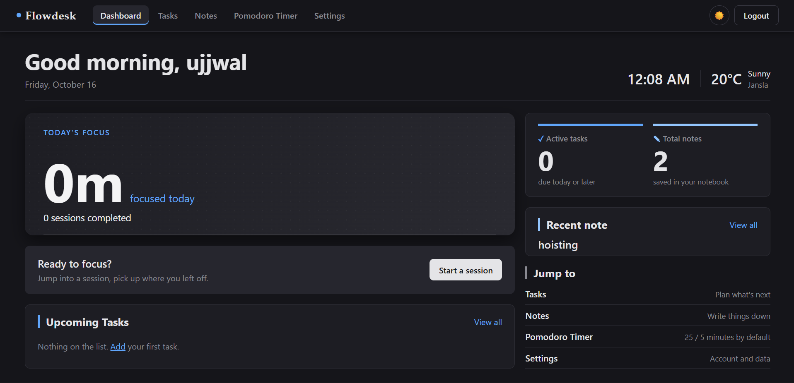
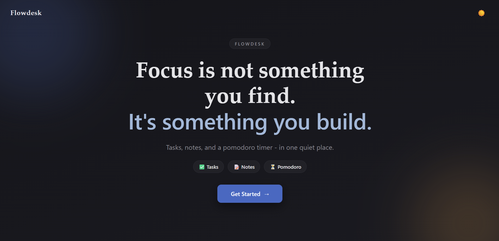
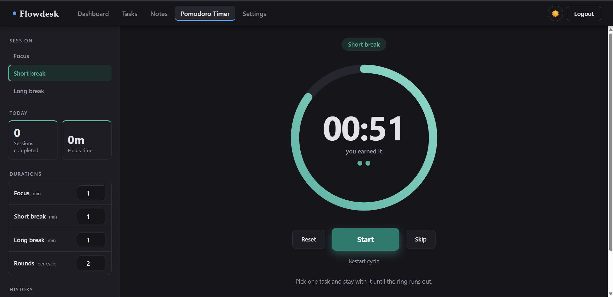

# Flowdesk

**A small, quiet productivity app: tasks, notes and a pomodoro timer in one place.**

Flowdesk is a frontend-only web app I built with plain HTML, CSS and JavaScript as my Web Fundamentals project. No frameworks, no libraries, no build step. Everything you add is saved in your own browser, so it works without a backend or an account on any server.

I wanted one tab I could keep open while studying: a place to plan what's next, write things down, and actually sit with one task for 25 minutes. That's Flowdesk.

**Live demo:** [flowdesk-ujjwal.vercel.app](https://flowdesk-ujjwal.vercel.app/)



---

## Contents

- [Features](#features)
- [Tech used](#tech-used)
- [Getting started](#getting-started)
- [How it works](#how-it-works)
- [Deployment](#deployment)
- [Project proposal](#project-proposal)
- [Known limitations](#known-limitations)
- [What I'd add next](#what-id-add-next)
- [License](#license)

---

## Features

### Landing and login
- Landing page with a short intro and a **Get Started** button
- Register and log in with a username and password
- Passwords are **hashed with the Web Crypto API** (PBKDF2 + SHA-256 with a random salt per user), so the real password is never saved
- If you're already logged in, you go straight to the dashboard



### Dashboard
- Greeting based on the time of day, today's date and a live clock
- Local weather (uses your location, asks for permission first, and shows a clear message if it's blocked)
- **Today's focus time** and sessions completed, from the timer
- Your next two upcoming tasks and your most recent note
- Quick links to every page
- On a normal desktop screen the whole dashboard fits without scrolling

### Tasks (full CRUD)
- Add a task with a due date, then **edit**, **complete** or **delete** it
- Filters: **All, Active, Completed, Today, Missed**
- Search tasks as you type
- Can't add a task with a past date or a duplicate name
- Asks before deleting
- Browser **notification reminders** for tasks due today (once per task)
- Changes made in another tab show up here too

### Notes (full CRUD)
- Create, open, **edit** and **delete** notes
- Organise notes by **category** (make a new category right from the editor)
- Search notes by title
- Warns you before you lose unsaved changes
- Pasting from a website keeps only the plain text
- Drag the column edges to resize the sidebar and the notes list

### Pomodoro timer
- **Focus, Short break and Long break** modes, each with its own colour
- Set your own durations and how many rounds make a cycle
- Runs in a **Web Worker**, so it keeps accurate time even when the tab is in the background
- Keeps running when you move to another page of the app
- When a session ends: a sound, a browser notification and a full-screen overlay, **on whichever page you're on**
- Daily history of sessions and focus minutes



### Settings
- Change your password
- **Clear all data** for your account (with a confirmation, since it can't be undone)

### Everywhere
- **Dark mode** that remembers your choice
- Responsive layout for **mobile, tablet and desktop**
- Every page except the landing page is protected, so you can't open it without logging in
- Keyboard-friendly: visible focus outlines, and categories and note cards work with Enter and Space

---

## Tech used

| | |
|---|---|
| **Languages** | HTML5, CSS3, JavaScript (ES6+) |
| **Storage** | `localStorage` for app data, `sessionStorage` for the login session |
| **Browser APIs** | Web Crypto, Web Workers, Notifications, Web Audio, Geolocation, Fetch, DOMParser |
| **Weather data** | [Open-Meteo](https://open-meteo.com/) for the weather and [Nominatim](https://nominatim.org/) for the city name (both free, no API key) |
| **Libraries** | None |

CSS uses custom properties (variables) for every colour, so light and dark mode are just two sets of values. Layouts use Flexbox and Grid, with media queries for smaller screens.

---

## Getting started

### Try it online

The easiest way is the live version: **[flowdesk-ujjwal.vercel.app](https://flowdesk-ujjwal.vercel.app/)**. Register an account and start using it. Nothing to install.

To run it on your own computer instead, follow the steps below.

### Prerequisites

- A modern browser (Chrome, Edge, Firefox or Safari)
- A way to serve the folder locally, for example:
  - the **Live Server** extension for VS Code, or
  - **Python 3** (comes with a simple built-in server)

> **Why a local server?** The navbar is loaded with `fetch()` and the timer runs in a Web Worker. Browsers block both when you open an HTML file directly from your computer (`file://`), so the app needs to be served over `http://localhost`.

### Run it

1. **Clone the repository**
   ```bash
   git clone https://github.com/buildwithujjwal/Flowdesk.git
   cd Flowdesk
   ```

2. **Start a local server** (pick one)

   **Option A: VS Code + Live Server**
   - Open the `Flowdesk` folder in VS Code
   - Right-click `views/index.html` → **Open with Live Server**

   **Option B: Python**
   ```bash
   python -m http.server 8000
   ```
   Then open **http://localhost:8000/views/index.html** in your browser.

3. **Create an account.** Click **Get Started**, then *Don't have an account yet?*, and register.

4. You'll land on the dashboard. That's it!

> Tip: allow notifications when the tasks page or the timer asks. That's how reminders and end-of-session alerts reach you when the tab isn't in front.

---

## How it works

### Project structure

```
Flowdesk/
├── views/              # one HTML file per page
│   ├── index.html      # landing + login / register
│   ├── dashboard.html
│   ├── tasks.html
│   ├── notes.html
│   ├── timer.html
│   └── settings.html
├── css/                # one stylesheet per page, plus the navbar
│   ├── style.css       # landing + login
│   ├── nav.css         # navbar, shared page layout, timer alert overlay
│   ├── dashboard.css
│   ├── tasks.css
│   ├── notes.css
│   ├── timer.css
│   └── settings.css
├── js/
│   ├── auth.js         # login, register, password hashing
│   ├── auth-gaurd.js   # protects pages, applies the saved theme
│   ├── nav.js          # loads the navbar, logout, theme toggle, timer alert on other pages
│   ├── dashboard.js
│   ├── tasks.js
│   ├── notes.js
│   ├── timer.js
│   ├── timer-worker.js # the countdown that runs in a Web Worker
│   └── settings.js
├── partials/
│   └── nav.html        # navbar shared by every page
├── docs/               # screenshots used in this README
├── vercel.json         # sends the site root to the login page on Vercel
├── LICENSE
└── README.md
```

*(Yes, `auth-gaurd.js` is spelled that way on purpose. Every page already points to it.)*

### Where the data lives

Everything is stored in the browser. Tasks and notes from all users on the same browser share one list, and each item carries a `username` so every user only sees their own.

| Key | Storage | What's inside |
|---|---|---|
| `users` | localStorage | `[{ username, salt, passwordHash }]` |
| `tasks` | localStorage | `[{ id, username, text, dueDate, completed, createdAt, reminderSent }]` |
| `notes` | localStorage | `[{ id, username, title, content, category, createdAt }]` |
| `pomodoro_<username>` | localStorage | `{ settings, session, history }` for each user |
| `theme` | localStorage | `"light"` or `"dark"` |
| `currentUser` | sessionStorage | `{ username, userLoggedInAt }`, gone when the tab closes |
| `pomodoro_endTime_<username>` | sessionStorage | when the running session ends, so the timer survives page changes |

### A few things I'm proud of

- **The timer keeps going across pages.** When a session starts, its end time is saved. Every page checks it, and if the session ends while you're on, say, the notes page, the overlay and sound still show up there.
- **Passwords are never stored.** Register and login use PBKDF2 from the Web Crypto API. Older accounts made before hashing still work, and their plain password is swapped for a hash on their next login.
- **No HTML injection.** Task titles, note titles and category names are escaped before being added to the page, so typing `<script>` just shows the text.
- **Two tabs don't overwrite each other.** Tasks and notes listen for the `storage` event and reload when another tab changes them.

---

## Deployment

The live site is hosted on **[Vercel](https://vercel.com/)** and redeploys automatically on every push to `main`.

Because it's a static site, there's nothing to build. The Vercel project uses:

| Setting | Value |
|---|---|
| Framework preset | Other |
| Root directory | `./` |
| Build / install command | none |

The login page lives at `views/index.html`, not at the root, so `vercel.json` redirects `/` there. It's a redirect rather than a rewrite on purpose: the pages use relative links like `dashboard.html` and `../css/...`, which only work when the address bar is inside `/views/`.

```json
{
  "redirects": [
    { "source": "/", "destination": "/views/index.html", "permanent": false }
  ]
}
```

---

## Project proposal

### Description

Flowdesk is a browser-based productivity workspace for students. It brings together a task list, a notes app and a pomodoro focus timer behind a simple login, with a dashboard that shows the day at a glance. It runs fully on the frontend and stores data with Web Storage.

### Goals

1. Build a multi-page app using **only HTML, CSS and JavaScript**, with no external libraries.
2. Implement full **CRUD** for tasks and notes.
3. Persist all data with **Web Storage** and keep each user's data separate.
4. Make every page **responsive** on mobile, tablet and desktop.
5. Use a range of browser APIs (Web Workers, Notifications, Web Audio, Geolocation, Fetch, Web Crypto) in a way that actually helps the user.
6. Keep the code readable and explainable: plain functions and clear comments.

### Specifications

**Functional**

| Area | Requirement |
|---|---|
| Auth | Register, log in, log out. Protected pages redirect to login without a session. Passwords stored only as salted hashes. |
| Dashboard | Greeting, date, clock, weather, today's focus stats, next two tasks, latest note, quick links. |
| Tasks | Create with text + due date, read, update (edit text/date, mark complete), delete. Filter, search, validation, due-today reminders. |
| Notes | Create with title, content and category, read, update, delete. Filter by category, search by title, unsaved-changes warning. |
| Timer | Focus / short / long modes, custom durations and rounds, start, pause, reset, skip, restart cycle, alerts, daily history. |
| Settings | Change password, clear all of the user's data. |
| Theme | Light/dark toggle saved across visits. |

**Non-functional**

- Works in current versions of Chrome, Edge, Firefox and Safari
- Responsive down to about 360px wide
- No frameworks, libraries or build tools
- All colours defined as CSS variables with light and dark values
- Inputs are validated and user text is escaped before rendering

### Design

**Pages and flow**

```
index.html (landing → login / register)
        │  login creates a session
        ▼
dashboard.html ◄──► tasks.html ◄──► notes.html ◄──► timer.html ◄──► settings.html
        (shared navbar on every page · logout returns to index.html)
```

- Every protected page loads `auth-gaurd.js` first. No valid session means a redirect to the login page.
- The navbar lives in one file (`partials/nav.html`) and is loaded into each page by `nav.js`, so it only has to be changed in one place.
- Each page has its own CSS and JS file, so pages don't depend on each other's code.

**UI**

- A calm black-and-blue palette: soft blacks for the base, one blue accent for actions and selected states. The timer gives each mode its own accent (blue, green, purple) so you can tell them apart at a glance.
- Sidebars on Tasks, Notes, Timer and Settings all use the same filter style: a tinted background and a coloured line on the selected item.
- One solid primary button per screen (Add Task, Save, Start, Update password), with lighter text buttons for secondary actions and red for destructive ones.
- System fonts only, so nothing is downloaded and text renders natively on every device.

---

## Known limitations

- **It's frontend-only.** All data lives in one browser on one device. Clearing site data, or using another browser, means starting fresh, and there's no sync between devices.
- **Login is for separating users on a shared browser, not real security.** Passwords are hashed, but anyone with access to the device and its browser storage can still reach the data.
- **Storage is limited** to about 5 MB per site. Saving a note shows an error if the limit is reached.
- **It needs a secure page** (`localhost` or `https`) for password hashing and IDs. Opening it over a plain LAN address like `http://192.168.x.x` shows a message instead of logging in.
- **Weather** depends on two free public services and on location permission. If either isn't available, the dashboard shows a message instead.

---

## What I'd add next

- Show missed and due-today tasks with their own colour
- Note counts next to each category
- A weekly focus chart and a daily focus goal on the dashboard
- Export and import data as a JSON file, as a backup

---

## License

This project is open source under the [MIT License](LICENSE).

---

Made by [@buildwithujjwal](https://github.com/buildwithujjwal) as part of the Web Fundamentals 2026 course.
